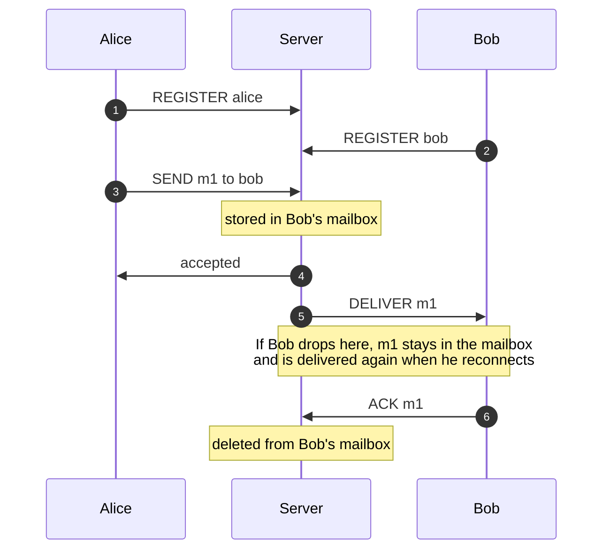

# APPROACH

How the relay works and why. Build and run instructions are in [README.md](README.md).

## Acceptance criteria

| # | Requirement | Test |
|---|---|---|
| 1 | Several clients register with unique ids | `RelayServerTest.happyPathSendDeliverAck` |
| 2 | A client sends a uniquely identified message to another | `happyPathSendDeliverAck` |
| 3 | The server confirms accept or reject | `sendsAreRejectedWithAReason` |
| 4 | The recipient receives it and explicitly acknowledges | `happyPathSendDeliverAck` |
| 5 | Messages for an offline client are kept, within limits | `offlineMessagesAreDeliveredOnReconnect`, `sendsAreRejectedWithAReason` |
| 6 | Reconnecting with the same id delivers the offline messages | `offlineMessagesAreDeliveredOnReconnect` |
| 7 | Delivered but unacknowledged messages are redelivered after reconnect | `unackedMessageIsRedeliveredAfterReconnect` |

Also tested: takeover by a new connection, FIFO across a reconnect, connection and frame limits,
a client that stops reading, bad input, and shutdown. Optional bonuses: FIFO ordering and a Docker image are done;
persistence is not done.

## Architecture

```
client ──TCP──▶ ClientConnection ──▶ Registry ──▶ Mailbox (one per client id)
```

- **`ClientConnection`** (one per socket) has a reader thread, a writer thread and a bounded queue between them. It is temporary and holds no messages.
- **`Registry`** maps each client id to its `Mailbox` and keeps it for the server's lifetime.
- **`Mailbox`** holds that client's messages. Because it outlives the connection, a client can disconnect and reconnect without losing anything.

| Package | Contents |
|---|---|
| `protocol` | Framing and message types (`FrameCodec`, `Message`) |
| `mailbox` | Per-client message state; no networking |
| `server` | `RelayServer` (accept, limits, shutdown), `ClientConnection`, `Registry`, `ServerConfig` |
| `client` | `RelayCli`, a demo client |

## Protocol

Each frame is a 4-byte length followed by that many bytes of JSON. The length lets the server
find message boundaries in the TCP stream and reject an oversized frame before reading it.

| Client → server | Server → client |
|---|---|
| `REGISTER client_id` | `REGISTERED pending` (messages waiting) |
| `SEND id to body` | `SEND_RESULT id accepted code?` |
| `ACK id from` | `DELIVER id from body` |
| `PING` | `PONG`, `ERROR code` |



### Connection lifecycle

- **Connect:** over the connection limit, the client gets `SERVER_BUSY` and is closed.
- **Register:** must happen within 5s. Anything sent before it gets `NOT_REGISTERED`.
- **Reconnect:** the client sends `REGISTER` with the same id. There is no authentication. If the id is still connected elsewhere, the new connection replaces the old one, because a dropped connection can look alive for a while.
- **Active:** any frame resets a 60s idle timer; quiet clients send `PING`.
- **Close:** for any reason, messages that were delivered but not acknowledged go back to the front of the mailbox.

**Errors:** if the byte stream can't be trusted (bad frame length), the server sends an error and
closes. If the frame is fine but the request is invalid (bad JSON, unknown recipient, full
mailbox), it replies with an error code and the connection stays open.

## State model

Each mailbox has two queues and a short memory:

```
pending ──deliver──▶ in flight ──ACK──▶ removed
```

- **pending:** waiting to be sent. **in flight:** sent, waiting for an ACK.
- The size limit counts both. When full, new messages are rejected (`MAILBOX_FULL`); accepted ones are never dropped.
- A bounded set of recent `(from, id)` pairs detects duplicate sends.

## Concurrency model

- **Two virtual threads per connection:** a reader and a writer. Only the writer touches its socket, so a client that stops reading can only stall itself. Its queue is bounded, and when full the client is disconnected; its messages stay in the mailbox.
- **One lock per mailbox:** each operation (store, deliver, acknowledge) is a single locked step. No lock is held during network I/O.
- **Waking the writer:** when a mailbox gets something deliverable, it puts one "check mailbox" signal on the connection's queue.
- **Tickets:** each connection that attaches to a mailbox gets a new ticket. A replaced connection's old ticket is ignored, so it can't interfere with the new one.
- **Shutdown:** stop accepting, tell clients `SHUTTING_DOWN`, close connections, then wait up to a grace period.

## Delivery semantics

| | |
|---|---|
| Delivery | At-least-once: removed only on ACK, so a client may see a message twice after a reconnect |
| `accepted` | Stored in the recipient's mailbox (not yet delivered) |
| Ordering | FIFO per recipient, including across reconnects (one message in flight at a time) |
| Duplicate send | Same id and body: `accepted` with `DUPLICATE`, not stored twice. Same id, different body: `ID_REUSED` |
| Stale or repeated ACK | Ignored, with `ACK_UNKNOWN` |

## Design notes in the code

Comments tagged `[Q1]` to `[Q9]` mark where each of these decisions is implemented
(`grep -rn "\[Q" src/`):

| Tag | Topic |
|---|---|
| Q1 | Idle and register timeouts, heartbeat |
| Q2 | Reconnecting while the old connection is still open (tickets) |
| Q3, Q4 | Duplicate detection: what's remembered, and where |
| Q5 | Input validation; close vs reply |
| Q6 | Shutdown order |
| Q7 | Slow clients |
| Q8 | Writes that never finish |
| Q9 | How the writer waits for replies and new mail |

## Trade-offs

| Choice | Instead of | Because |
|---|---|---|
| Raw TCP, custom protocol | HTTP / gRPC | The protocol is the point of the exercise |
| Blocking sockets on virtual threads | NIO selector | Simpler code that's still cheap per connection |
| One message in flight per client | A window of several | Strict ordering, at the cost of throughput |
| Disconnect a client that can't keep up | Blocking or dropping | Blocking stalls others; dropping loses data |
| New connection wins | Reject the newcomer | Avoids locking out a client whose old connection is dead but not yet detected |

## Known limitations

- In memory only: a restart loses all messages.
- No authentication: anyone can claim any id.
- Mailboxes are never removed, so memory grows with the number of distinct ids.
- Redelivery happens only on reconnect (no ACK timeout).
- Duplicate detection only covers recent ids.

## Next steps

1. Persist mailboxes (an append-only log replayed on startup).
2. Redeliver after an ACK timeout, not only on reconnect.
3. A CI workflow running `./mvnw -B verify` and building the image.
4. Expire unused mailboxes; add authentication.

## AI usage

Built with Claude (Claude Code).

- **Design:** the main design questions (timeouts, reconnects, duplicates, slow clients, shutdown) were worked through in conversation before coding. Claude asked questions and reviewed my answers.
- **Code:** Claude first gave me skeletons to fill in; I wrote part of the protocol layer that way, then asked it to generate the rest. I walked through each part with it until I could explain it.
- **Verification:** every step was built and tested; the concurrency-sensitive tests were run 20–30 times in a row; the real jar was run end to end with the demo client. The build and tests caught several AI mistakes, which were fixed.
- The step-by-step log is in [AI_NOTES.md](AI_NOTES.md).
